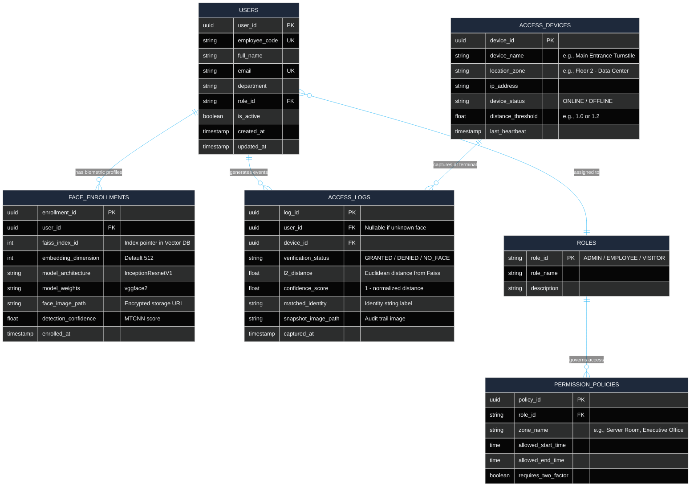
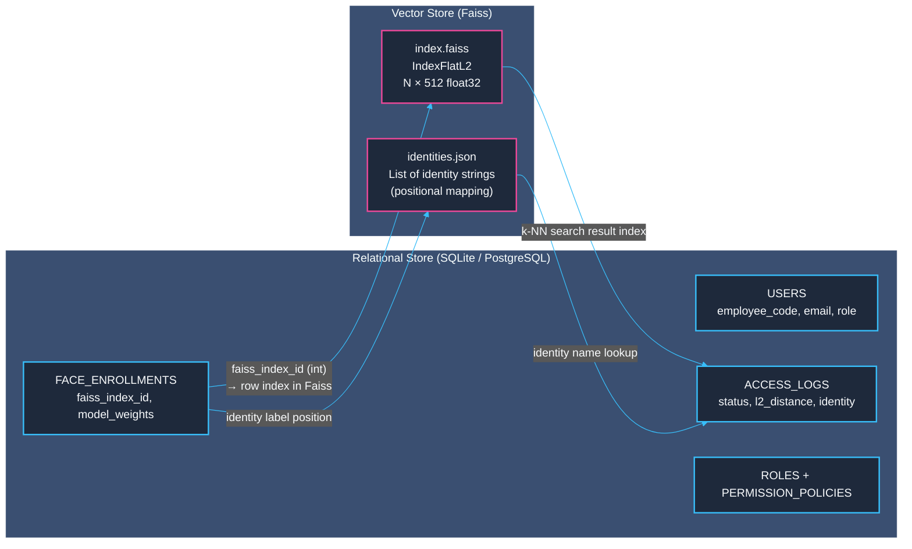

# Entity Relationship Diagram (ERD)
# Face Recognition & Access Control System

**Project:** Face Recognition System Multimodal AI  
**Developer:** Aryan Singh (Reg No: 240410700030)  
**Semester:** 5th Semester  

---

## 1. System Entity Relationship Diagram

---

## 2. Relational Mapping & Vector DB Hybrid Model

In an enterprise multimodal AI architecture:
- **Relational Metadata (PostgreSQL / SQLite):** Stores user identity profiles, device credentials, audit logs, and access policies.
- **In-Memory Vector Store (Faiss):** Stores the dense 512-dimensional floating-point embeddings (`IndexFlatL2`).
- **Foreign Key Bridge:** `FACE_ENROLLMENTS.faiss_index_id` maps the relational record directly to the internal position in `index.faiss` and `identities.json`.

### Hybrid Storage Architecture

---

## 3. Data Dictionary

| Table | Column | Type | Constraints | Description |
|---|---|---|---|---|
| `USERS` | `user_id` | UUID | PK, NOT NULL | Unique identifier for employee |
| `USERS` | `employee_code` | VARCHAR(50) | UNIQUE, NOT NULL | Organization badge/ID code |
| `USERS` | `full_name` | VARCHAR(100) | NOT NULL | Display name |
| `FACE_ENROLLMENTS` | `enrollment_id` | UUID | PK, NOT NULL | Unique face sample entry |
| `FACE_ENROLLMENTS` | `faiss_index_id` | INTEGER | NOT NULL | Row index in Faiss vector matrix |
| `FACE_ENROLLMENTS` | `embedding_dimension` | INTEGER | DEFAULT 512 | Length of feature vector |
| `ACCESS_DEVICES` | `device_id` | UUID | PK, NOT NULL | Edge camera or turnstile reader |
| `ACCESS_LOGS` | `log_id` | UUID | PK, NOT NULL | Immutable verification log entry |
| `ACCESS_LOGS` | `l2_distance` | FLOAT | NULLABLE | Vector distance from nearest neighbor |
| `ACCESS_LOGS` | `verification_status` | ENUM | NOT NULL | `GRANTED`, `DENIED`, `NO_FACE` |
