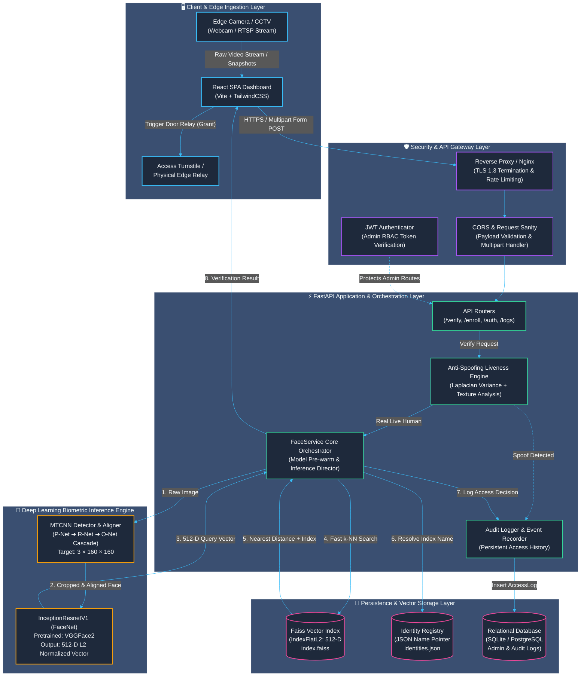
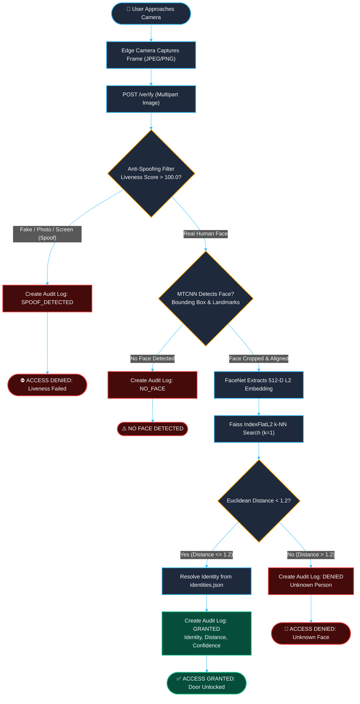
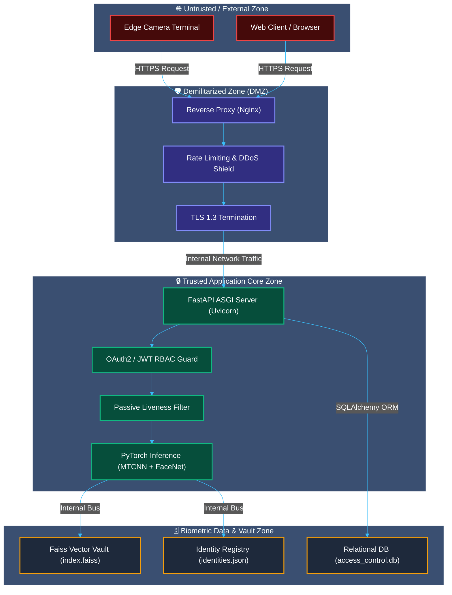
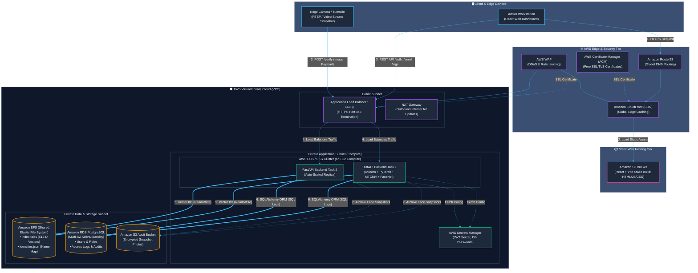

# High Level System Design (HLD)
# Face Recognition & Access Control System — Multimodal AI

**Developer:** Aryan Singh (Reg No: 240410700030)  
**Semester:** 5th Semester  
**Project Track:** Face Recognition System Multimodal AI  
**Version:** 2.0.0  

---

## 1. Executive System Overview

The **Enterprise Multimodal Face Recognition & Access Control System** provides real-time, zero-shot biometric identity verification, employee enrollment, anti-spoofing liveness verification, and tamper-evident audit logging. 

It fuses deep convolutional neural networks (**MTCNN** and **Inception-ResNet-v1 FaceNet**) with high-performance vector indexing (**Facebook AI Similarity Search - Faiss**) and an asynchronous REST API layer (**FastAPI**), managed by a secure **React** single-page management dashboard.

---

## 2. End-to-End System Architecture (Macro View)



---

## 3. Tiered / Layered Architecture Diagram

```mermaid
%%{init: {
  'theme': 'dark',
  'themeVariables': {
    'darkMode': true,
    'background': '#0f172a',
    'mainBkg': '#1e293b',
    'textColor': '#f8fafc',
    'primaryColor': '#1e293b',
    'primaryTextColor': '#f8fafc',
    'primaryBorderColor': '#38bdf8',
    'lineColor': '#38bdf8'
  }
}}%%
flowchart TD
    subgraph PRESENTATION["1. Presentation Tier (Frontend UI)"]
        direction LR
        P1["Live Webcam Feed & Overlay"]
        P2["Biometric Verification HUD"]
        P3["Employee Enrollment Panel"]
        P4["Audit Logs & Analytics Dashboard"]
    end

    subgraph API_GATEWAY["2. Gateway & Security Tier"]
        direction LR
        G1["FastAPI CORS Middleware"]
        G2["JWT Bearer Authentication"]
        G3["Pydantic v2 Request/Response Validation"]
    end

    subgraph APPLICATION_SERVICES["3. Core Business & Application Services Tier"]
        direction LR
        S1["FaceService Core Engine"]
        S2["LivenessService (Anti-Spoofing)"]
        S3["SecurityService (Password Hashing / Tokens)"]
        S4["AuditService (Access Tracking)"]
    end

    subgraph AI_PIPELINE["4. Deep Learning AI & Vision Tier"]
        direction LR
        M1["MTCNN Face Detector & Landmark Aligner"]
        M2["FaceNet (Inception-ResNet-v1) Feature Extractor"]
        M3["PyTorch CUDA / CPU Tensor Runtime Engine"]
    end

    subgraph DATA_PERSISTENCE["5. Persistence & Vector Storage Tier"]
        direction LR
        D1["Faiss IndexFlatL2 (In-Memory + Disk Sync)"]
        D2["SQLite / PostgreSQL DB (SQLAlchemy ORM)"]
        D3["Identity Label Mapping (identities.json)"]
    end

    PRESENTATION ==> API_GATEWAY
    API_GATEWAY ==> APPLICATION_SERVICES
    APPLICATION_SERVICES ==> AI_PIPELINE
    APPLICATION_SERVICES ==> DATA_PERSISTENCE
    AI_PIPELINE -.->|"Write/Query Vectors"| DATA_PERSISTENCE

    classDef tier1 fill:#1e293b,stroke:#38bdf8,stroke-width:2px,color:#f8fafc;
    classDef tier2 fill:#1e293b,stroke:#a855f7,stroke-width:2px,color:#f8fafc;
    classDef tier3 fill:#1e293b,stroke:#34d399,stroke-width:2px,color:#f8fafc;
    classDef tier4 fill:#1e293b,stroke:#f59e0b,stroke-width:2px,color:#f8fafc;
    classDef tier5 fill:#1e293b,stroke:#ec4899,stroke-width:2px,color:#f8fafc;

    class P1,P2,P3,P4 tier1;
    class G1,G2,G3 tier2;
    class S1,S2,S3,S4 tier3;
    class M1,M2,M3 tier4;
    class D1,D2,D3 tier5;
```



---

## 4. End-to-End Operational Workflows

### 4.1 Verification & Access Decision Flow (High Level)



---

### 4.2 Zero-Shot Employee Enrollment Workflow (High Level)

```mermaid
%%{init: {
  'theme': 'dark',
  'themeVariables': {
    'darkMode': true,
    'background': '#0f172a',
    'mainBkg': '#1e293b',
    'textColor': '#f8fafc',
    'primaryColor': '#1e293b',
    'primaryTextColor': '#f8fafc',
    'primaryBorderColor': '#38bdf8',
    'lineColor': '#38bdf8'
  }
}}%%
flowchart LR
    ADMIN(["Security Admin"]) -->|"Enters Identity Name +\nUploads HD Portrait"| UI["Admin Portal (React)"]
    UI -->|"POST /enroll\n(Bearer JWT Token)"| GATEWAY["FastAPI Gateway"]
    GATEWAY -->|"Verify Admin Token"| AUTH["Security Engine"]
    AUTH -->|"Authorized"| MTCNN["MTCNN Face Detector"]
    MTCNN -->|"Extracts 160×160 Crop"| FACENET["InceptionResnetV1 Encoder"]
    FACENET -->|"512-D float32 Vector"| FAISS["FaissManager Engine"]
    
    subgraph ATOMIC_PERSIST["Atomic Storage Persistence"]
        direction TB
        FAISS -->|"1. index.add(vector)"| VEC_FILE[("index.faiss")]
        FAISS -->|"2. identities.append(name)"| MAP_FILE[("identities.json")]
    end
    
    ATOMIC_PERSIST -->|"Success Confirmation"| RESP["HTTP 200: Successfully Enrolled"]
    RESP --> UI

    classDef nodeStyle fill:#1e293b,stroke:#38bdf8,stroke-width:2px,color:#f8fafc;
    classDef persistStyle fill:#1e293b,stroke:#ec4899,stroke-width:2px,color:#f8fafc;
    classDef successStyle fill:#064e3b,stroke:#10b981,stroke-width:2px,color:#f8fafc;

    class ADMIN,UI,GATEWAY,AUTH,MTCNN,FACENET,FAISS nodeStyle;
    class VEC_FILE,MAP_FILE persistStyle;
    class RESP successStyle;
```



---

## 5. Security & Trust Boundary Architecture



---

## 6. AWS Cloud Deployment & Infrastructure Topology Diagram



### AWS Service Mapping & Architecture Decisions

| System Layer | AWS Service | Purpose in Architecture | Key Technical Rationale |
|---|---|---|---|
| **Frontend CDN & DNS** | **Amazon CloudFront + Route 53** | Global distribution of React single-page app and DNS resolution. | Edge caching reduces UI latency to < 50ms worldwide and offloads traffic from backend servers. |
| **Frontend Storage** | **Amazon S3 (Simple Storage Service)** | Host compiled static web assets (`index.html`, JavaScript, CSS). | Serverless, highly available (99.999999999% durability), and costs pennies per month compared to running a VM. |
| **SSL / TLS Encryption** | **AWS Certificate Manager (ACM)** | Manages public HTTPS certificates for CloudFront and ALB. | Free, auto-renewing SSL certificates securing communication from cameras and web browsers. |
| **API Gateway & Routing** | **Application Load Balancer (ALB)** | Reverse proxy, path routing (`/api/*`), and SSL termination. | Automatically health-checks FastAPI workers and distributes incoming verification traffic evenly. |
| **Compute & Inference** | **AWS ECS (Fargate) or EC2 (`g4dn` / `t3.large`)** | Runs containerized FastAPI, PyTorch (MTCNN + FaceNet), and Liveness engine. | Keeps heavy neural network weights pre-warmed in memory (eliminating the 5-10s cold-start delays of AWS Lambda). |
| **Vector Database Storage** | **Amazon EFS (Elastic File System)** | Persistent shared file system for `index.faiss` and `identities.json`. | Native POSIX network file system mountable across auto-scaled container tasks without rewriting Faiss code. |
| **Relational Database** | **Amazon RDS PostgreSQL (Multi-AZ)** | Stores admin users, credentials, roles, and immutable verification audit logs. | Fully managed SQL engine with automatic backups, failover, and zero-code migration via existing SQLAlchemy ORM. |
| **Secrets & Credentials** | **AWS Secrets Manager** | Stores JWT signing secret, database passwords, and encryption keys. | Eliminates plaintext secrets in source code and enables automatic credential rotation. |

---

## 7. State Machine Diagram: Access Verification Lifecycle

```mermaid
%%{init: {
  'theme': 'dark',
  'themeVariables': {
    'darkMode': true,
    'background': '#0f172a',
    'mainBkg': '#1e293b',
    'textColor': '#f8fafc',
    'primaryColor': '#1e293b',
    'primaryTextColor': '#f8fafc',
    'primaryBorderColor': '#38bdf8',
    'lineColor': '#38bdf8'
  }
}}%%
stateDiagram-v2
    [*] --> Standby: System Initialized (Models Pre-warmed)
    Standby --> FrameAcquired: Camera snapshot uploaded (/verify)
    
    FrameAcquired --> LivenessValidation: Check Laplacian variance & texture
    LivenessValidation --> SpoofDetected: Variance < 100.0 (Spoof/Photo)
    LivenessValidation --> FaceDetection: Variance >= 100.0 (Live human)

    SpoofDetected --> AuditLogged: Log verification_status = "SPOOF_DETECTED"
    
    FaceDetection --> NoFaceFound: MTCNN detects 0 faces
    FaceDetection --> FaceAligned: MTCNN detects bounding box + 5 landmarks
    
    NoFaceFound --> AuditLogged: Log verification_status = "NO_FACE"
    
    FaceAligned --> FeatureExtraction: Crop to 160×160 & forward to FaceNet
    FeatureExtraction --> VectorSearch: Produce 512-D float32 vector & query Faiss
    
    VectorSearch --> MatchVerified: Nearest distance <= 1.2
    VectorSearch --> MatchRejected: Nearest distance > 1.2
    
    MatchVerified --> AuditLogged: Log status = "GRANTED", identity, distance
    MatchRejected --> AuditLogged: Log status = "DENIED", unknown person
    
    AuditLogged --> Standby: Response returned to client
