# Low Level System Design (LLD)
# Face Recognition System — Multimodal AI

**Developer:** Aryan Singh (Reg No: 240410700030)  
**Semester:** 5th Semester  
**Project:** Face Recognition System  

---

## Module 1: Faiss Manager (Database Layer)

### Class Diagram

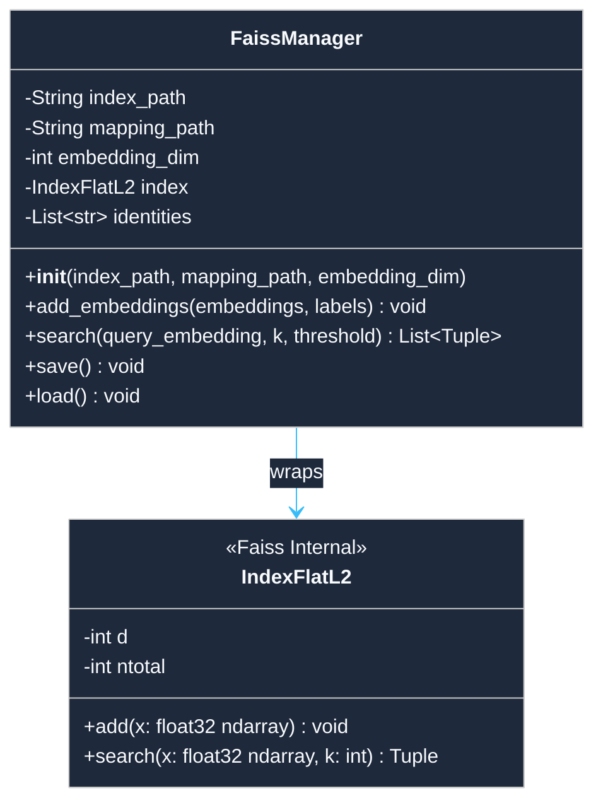

### Data Structures

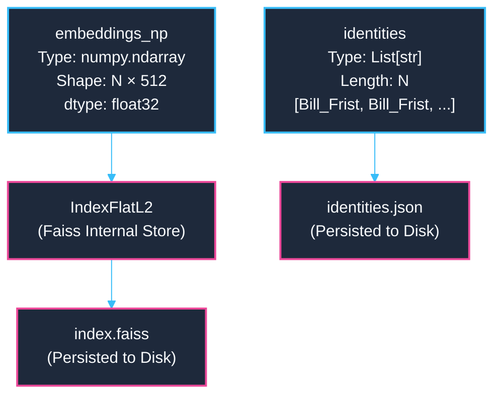

---

## Module 2: ML Pipeline (Face Encoder)

### Class Diagram

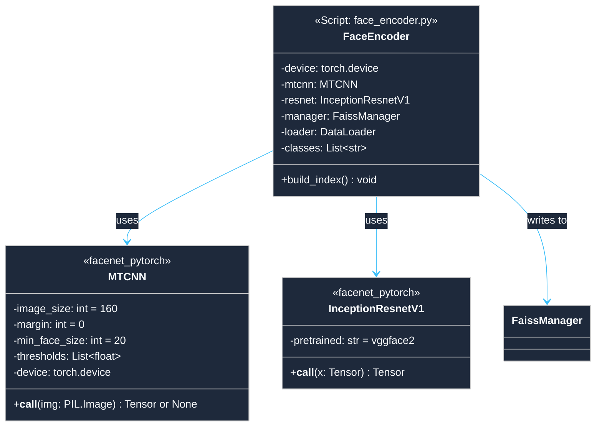

### Data Flow at Variable Level

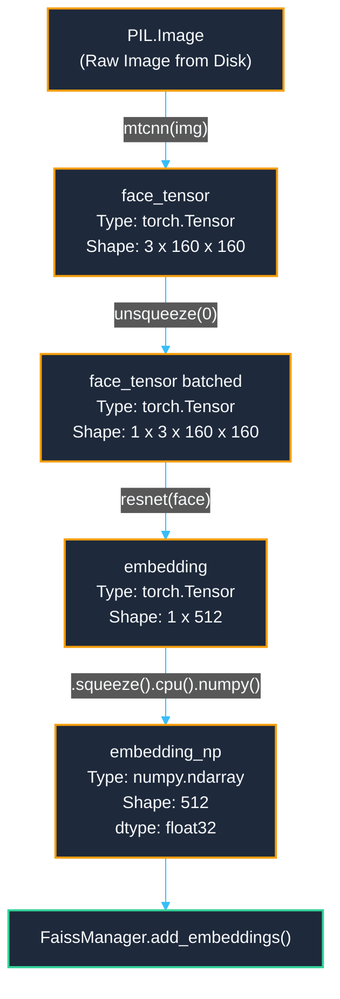

---

## Module 3: Face Verification (test_match.py)

### Class Diagram

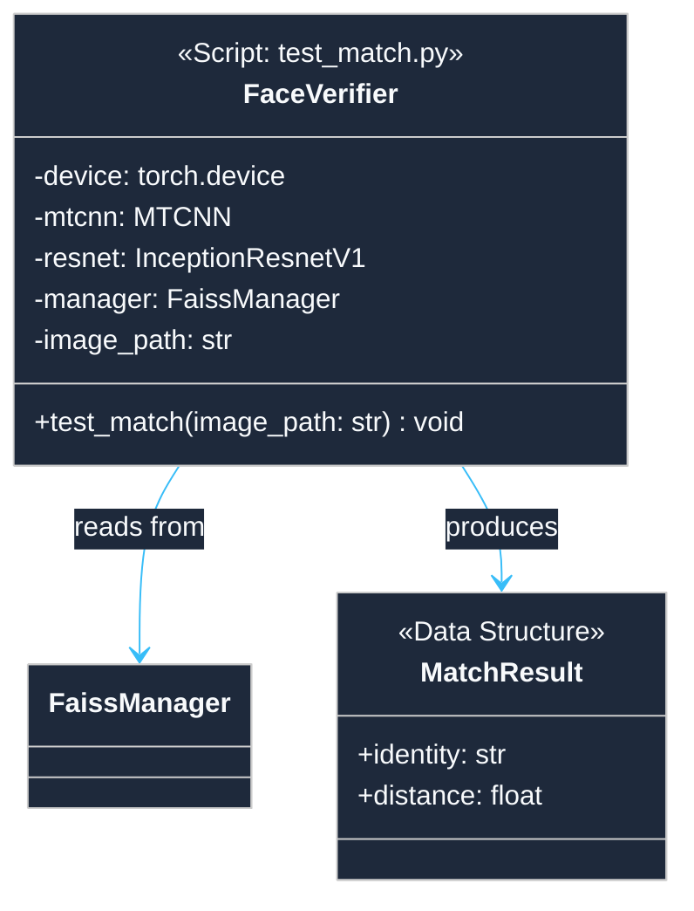

### Search Data Flow

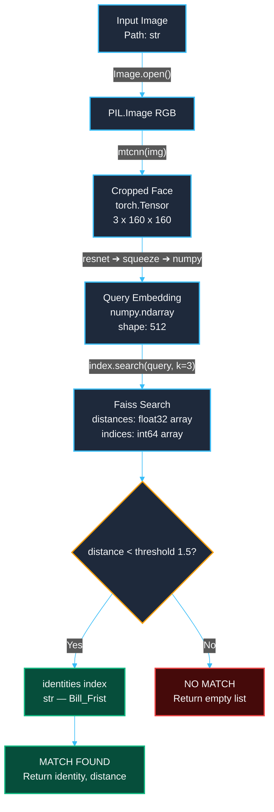

---

## Module 4: Dataset Loader

### Class Diagram

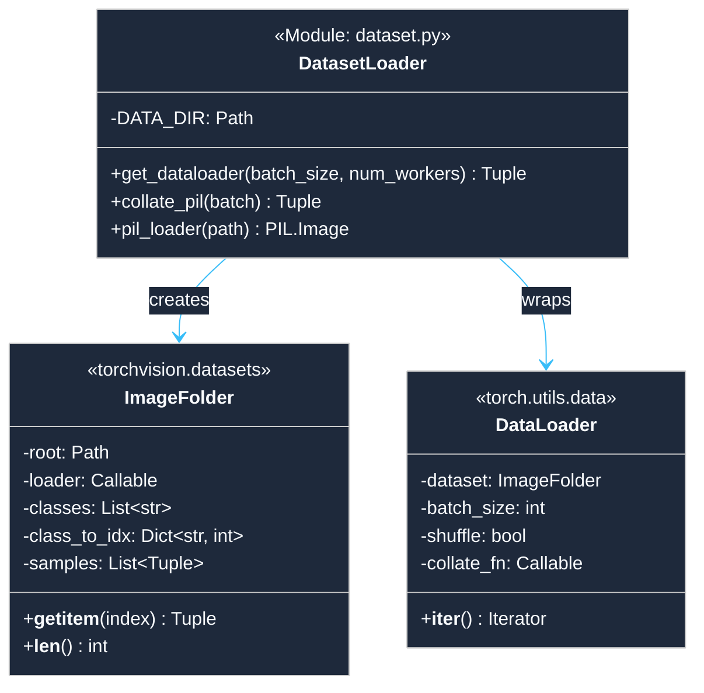

---

## Module 5: FastAPI Backend

### Class / API Diagram

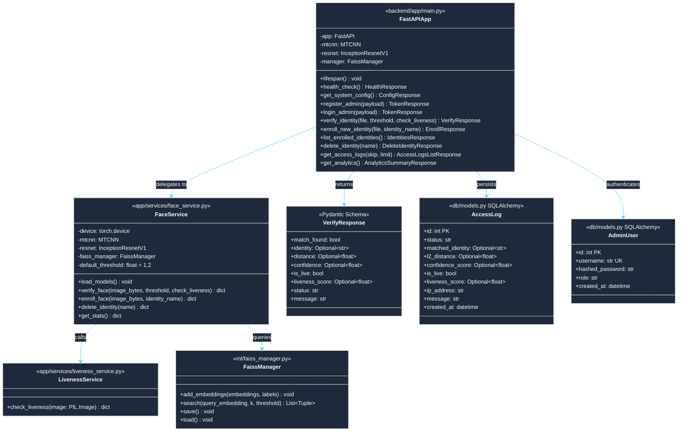

### Request/Response Sequence Diagram — POST /verify

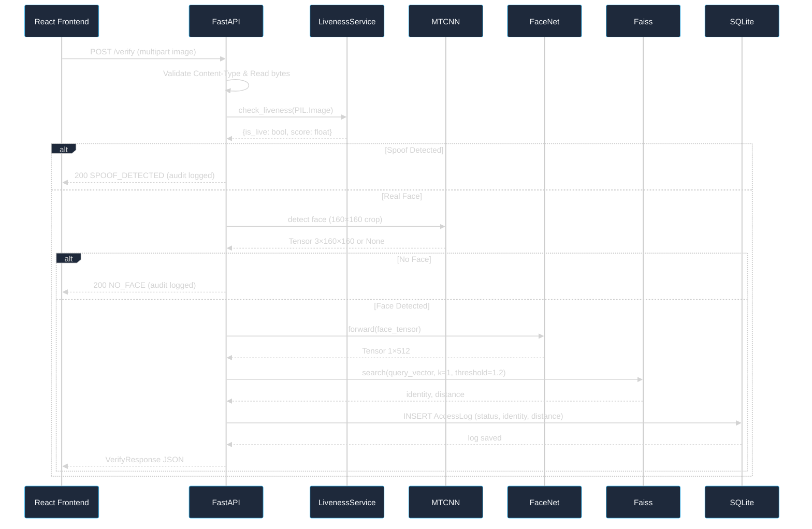

### Request/Response Sequence Diagram — POST /enroll (Admin Only)

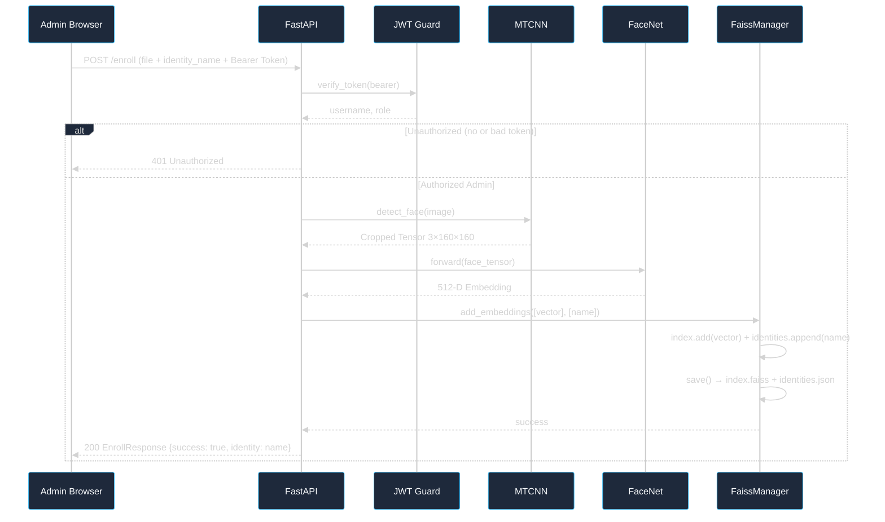

---

## Module 6: Liveness Anti-Spoofing Service

### Class Diagram

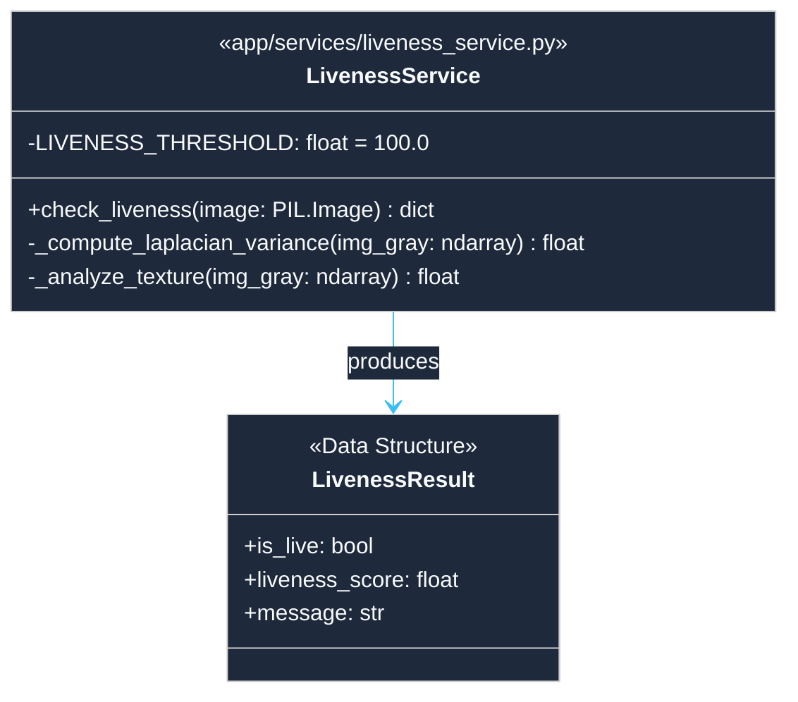

### Liveness Decision Flow

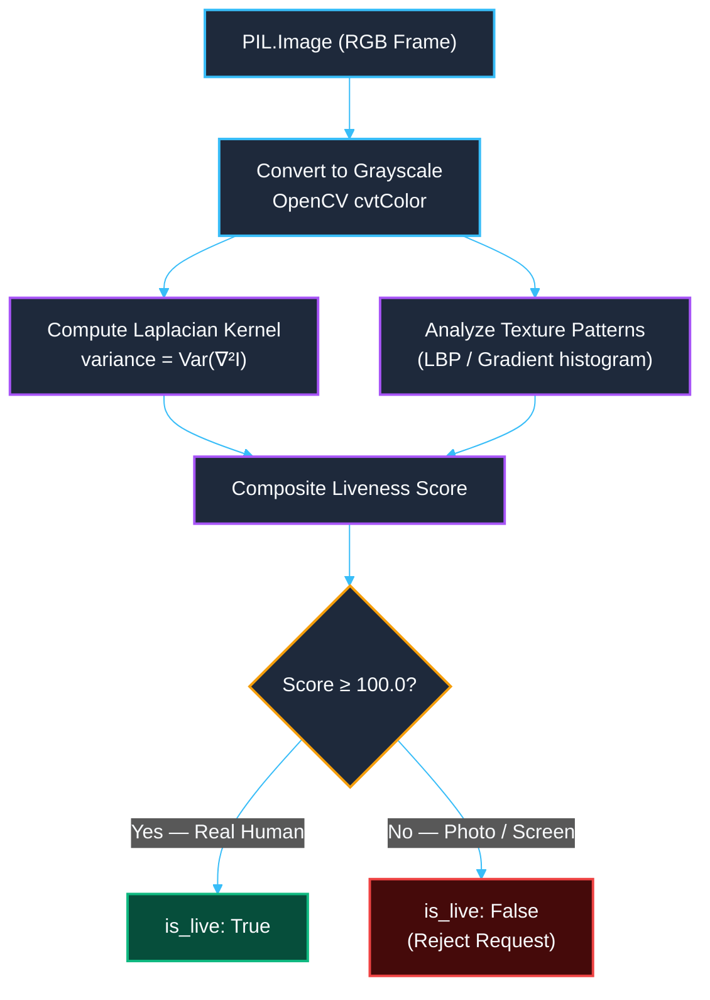

---

## Module 7: Database & ORM Layer

### SQLAlchemy Models Relationship Diagram

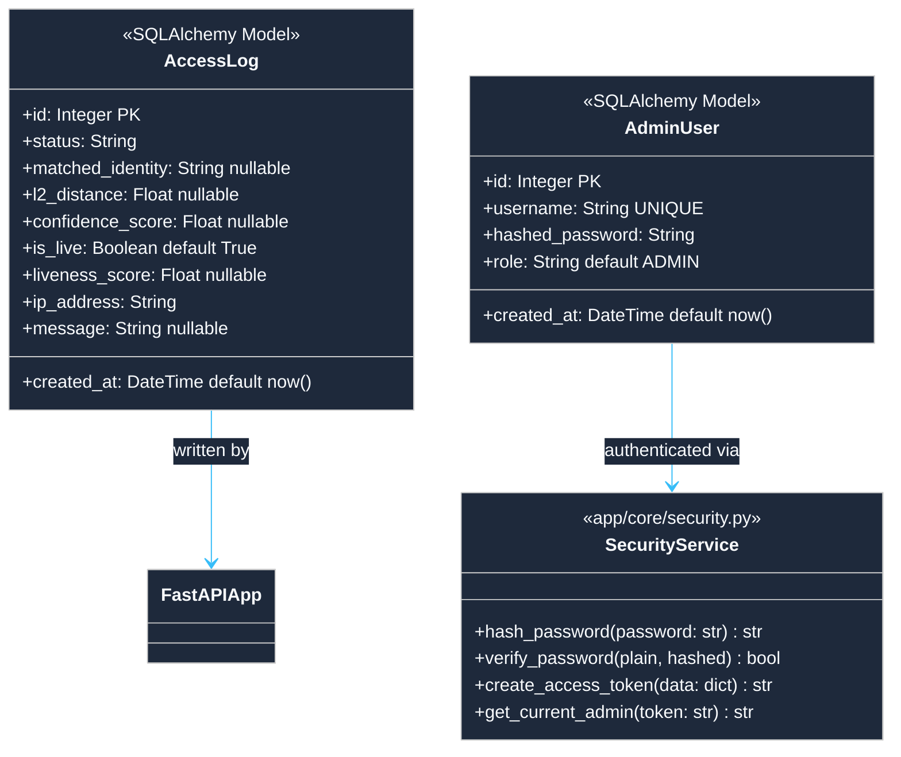
